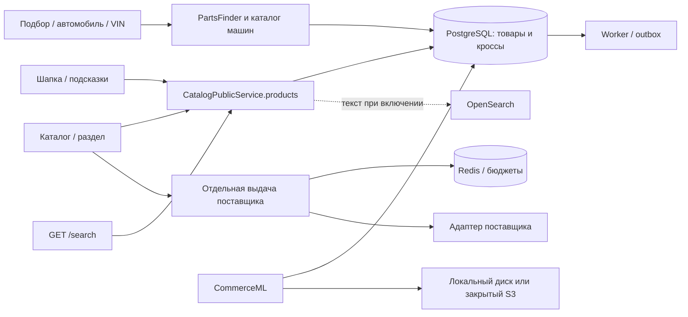

# Аудит АН-30: что проверено и что нужно для открытия

**Решение на 26.11.2026: закрытый стенд работает; открытие для покупателей пока не рекомендовано.** Эта ветка исправляет один конкретный случай потери аналогов и ошибку проверки схемы. Она не включает поставщиков, эквайринг или публичный checkout. Общее ТЗ — [оригинальный бриф](AGENT_BRIEF.md). Решения владельца о лицензиях, данных и выкладке из [AGENTS.md](../AGENTS.md) остаются в силе.

## Доказательства и границы

| Проверка | Что установлено | Что не доказывает |
| --- | --- | --- |
| Локальная сборка | Node 24.22.3, pnpm 11.9.0: lint, typecheck, базовые тесты и сборка Next.js прошли. У Python-эталона подбора 49 тестов прошли. | Работу внешних сервисов, реальной почты и всего Compose. Docker Hub ограничил скачивание; службы поднимались отдельно. |
| Живые службы | API: PostgreSQL, Redis и ClamAV доступны; worker: БД, Redis и очередь доступны на локальном стенде. | Доставку уведомления, обработку файла с рабочей 1С или восстановление после отказа. |
| Схема БД | До миграции проверка нашла 5 внешних ключей без индексов. После 0064: 90 таблиц, 115 FK, 318 индексов, smoke проходит. | Время построения индексов под нагрузкой на рабочей базе. Перед выкладкой репетиция на копии; не переписывать журнал миграций. |
| Поиск PostgreSQL | На прежнем наборе: 188/188 при C.UTF-8 против 124/188 при C. Новый тест на подтверждённый кросс сначала вернул пустой результат, после исправления находит нужную карточку. | Долю удачных запросов по реальному ассортименту. Фикстуры не источник товарных данных. |
| Обмен 1С / фото | Два товара с одинаковым артикулом остаются разными. Ошибка ожидания журнала зависела от того, был ли бренд MASUMA уже выведен из названия; фикстура изолирована от вывода бренда. На локальном S3-эмуляторе и PostgreSQL оба интеграционных теста фото прошли. | Права облачного бакета и настоящий архив 1С; проверки содержимого и антивируса в S3-тесте подставные. |
| Интерфейс | В отдельном браузерном прогоне проверялись поиск → товар → корзина, пересчёт, навигация и переходы к специалисту. В веб-тестах без API 17 прошли, 7 упали. | Эти семь — не семь доказанных дефектов магазина; разбирать отдельно ожидания устаревших тестов, API и состояние пользователя. |

## Закрытый рабочий каталог — отдельно от стенда

26.11: в браузере открыты раздел синтетических моторных масел, карточка масла Роснефть и раздел фильтров на 390 px. Отдельно выполнены десять последовательных запросов **только на чтение** к `GET /api/v1/catalog/products`, по 10 результатов, сортировка по релевантности, без фильтров цены и наличия. Все ответили 200. Поставщики, чат и оформление не вызывались. Это **не** нагрузочный тест, не измерение p95 и не проверка всех ролей.

| Ввести в каталоге | На рабочей версии до этой ветки | Что проверить до приёмки |
| --- | --- | --- |
| STELLOX 81-00110-SX; 81-00110-SX; стеллокс 8100110sx | По всем трём — 0. Сам KF6009SP находится (1 товар). | Одной правки поиска недостаточно. Сотруднику проверить в БД обе стороны связи, бренд, доказательства, статус и видимость товара. Только после независимого подтверждения ожидаем правильный товар с меткой аналога. |
| 87139-28010; LAC-201C | По одному результату: ST-87139-28010 и LAC-201C соответственно, оба как прямое совпадение. | Совпадение фрагмента не доказывает кросс. Сверить точность с каталогом производителя и ручной разметкой. |
| фильтр ниссан кашкай; регулятор давления Toyota Crown | 4 645 и 3 693 результата соответственно в режиме совпадения **части** слов. | Отдельно показывать ослабленный текстовый поиск и подтверждённую применимость. Замерить точность первых 10 по размеченным запросам с моделью/поколением; не считать найденное по одному слову подходящим авто. |
| тормозная жидкость DOT-4; xxzzqq | 28 результатов по всем словам и ожидаемый ноль соответственно. | Не расширять отрицательный контроль. Проверять переход нулевой выдачи до черновика специалиста. |

Срез выполнен на закрытом сайте без выкладки. Производственный журнал, таблицы с кроссами и приватные записи клиентов не читались. Визуальный аудит всех экранов клиента и сотрудника, безопасность, подключения и нагрузка выделены в отдельные работы. Невыполненные сценарии не считаются прошедшими.

## Архитектура и данные

Caddy принимает HTTP(S), Next.js обслуживает витрину/админку, NestJS/Fastify — API. Миграции версионируются в `packages/database/migrations`. Redis не является базой товаров. Развёртывание — Compose, миграция до перевода трафика на новый релиз. Продакшен не обновляется из этой ветки автоматически.

| Сущность | Источник истины | Важное отличие от брифа |
| --- | --- | --- |
| Товар, бренд, раздел | `app.products`, `brands`, `categories`; внешний ID 1С и принадлежность источнику | Артикул не уникален. Две базы 1С имеют отдельные пространства ID. Соответствие групп 1С — не публичное дерево разделов. |
| Цены и остатки | `product_prices`, `warehouses`, `inventory_balances`, журнал `inventory_events` | Предложение поставщика «под заказ» не становится нашим остатком. Сервер сам перепроверяет сумму и наличие. |
| OEM и кроссы | `app.article_crosses`: нормализованные номер **и бренд** с обеих сторон, оригинальное написание, источник, доказательства, отношение и статус. Идентификаторы брендов — `brand_identities`. | Не нужны новая пустая база или S3 для кроссов. Сначала измерить пробелы в текущих данных. Новую схему part_identifier/part_link вводить только с планом переноса происхождения и статусов. |
| Авто и применимость | `vehicle_catalog_makes/models/modifications` из лицензированного CSV, отдельно `parts_fitment` и проверка кнопкой у разрешённого поставщика | Наличие модели в справочнике не доказывает, что купленная деталь ей подходит. На чистом seed нет машин. |
| Фото | `product_images` → `storage_objects`; происхождение/отзыв — `image_rights_sources`, `product_image_withdrawals`. Файл на диске или в S3 согласно записи | Не подставлять фото аналога под видом собственного; внутренний архив UMAPI отличается от опубликованного изображения. [Инструкция S3](PRODUCT_PHOTOS_S3.md). |

**Входы поиска.** Подсказки шапки и каталог используют `/api/v1/catalog/products`; раздел добавляет фильтр, поэтому сравнивать выдачу надо при одинаковом контексте. `/search` делегирует туда же. SQL ранжирует точный номер, подтверждённый кросс, префикс и текст; сохраняется существующий поиск по фрагменту номера, что шире «только префикс» из брифа. Опечатки допустимы для слов, не являются доказательством эквивалентности деталей. OpenSearch опционален и не обслуживает конкретные номера. Поставщик запрашивается отдельно через `/suppliers/search`; распознавание авто — `/parts-finder/vehicles/understand`, выбор — `vehicles/suggest`, разрешение VIN и подбора — `/parts-finder/resolve`. Разделы машины берутся для выбранной модификации. Это не один общий индекс или контракт результата. Полный паритет пока не подтверждён.

**Обмен и интеграции.** 1С инициирует HTTPS CommerceML: авторизация → подготовка → отправка файла → применение частями. Каталог и цены/остатки приходят раздельно. Полная выгрузка отличается от дельты; при репетиции контролировать скрытые товары, отказы строк и повтор того же файла. Правила сортировки сопоставляют название и справочник разделов, сомнительные случаи проверяет сотрудник. Финальное расписание задаётся на стороне 1С. Подробности тарифов, кеширования, ролей данных: [матрица поставщиков](PROVIDERS.md). В проверенном runtime не найден экспорт товарных фидов на маркетплейсы; наличие внешних публикаций владельца не проверялось. Адресный виджет карты внешний, технические cookie используются для сессии/CSRF; документация указывает отсутствие рекламных счётчиков. Не вводить аналитику и маркетинговые cookie до согласования целей, срока хранения и согласия.

## Рабочие задачи в порядке выполнения

| Приоритет / статус | Воспроизведение → факт и влияние | Исправление и критерий приёмки |
| --- | --- | --- |
| P0 · барьер запуска | На закрытом магазине оформление — заявка менеджеру. Старый PROJECT_STATUS требует эквайринг, но [решение об оформлении](CHECKOUT_AND_PAYMENTS.md) уже другое. Снятие legal gate раньше времени откроет сбор данных. | Оставить флаги выключенными до подтверждения правовых текстов. Репетиция без оплаты: клиент видит условия, менеджер получает ровно одну заявку, сумма серверная. |
| P1 · исправлено в ветке (D-13) | Создать **синтетические** подтверждённые пары с одинаковым исходным номером у STELLOX и VALEO; ввести «STELLOX 81-00110-SX». Было: KF6009SP пропадал. | Бренд ограничивает исходную сторону связи; у найденной детали проверяется свой бренд. В тесте латиница/кириллица возвращают один нужный аналог с меткой cross, обратное направление для VALEO не смешивается. |
| P1 · исправлено в ветке | На чистой схеме до 0064 выполнить schema-smoke.sql: падает на пяти FK прав/фото. На CI тесты с БД пропускались. | Пять частичных индексов, обязательные миграции, smoke, поисковая регрессия и обмен 1С в CI. При миграции проверить продолжительность блокировок на копии рабочей БД. |
| P1 · подтверждено локально (D-16) | Нулевой запрос → заявка на подбор → «Написать в чат»: анкета не содержит запроса. Покупатель вводит его второй раз; тест перехода на справочную страницу не ловит потерю. | Передать контекст в черновик чата, не в лог/URL с VIN; не перетирать ручной ввод. E2E проходит **до поля**: тот же запрос виден, изменяем и не отправляется без действия пользователя. |
| P1 · расхождение состояний | При выключенном приёме заявок корзина предлагает гостевое оформление, а следующий шаг закрыт. Это не ошибка защитного барьера. | Согласовать CTA для закрытого и открытого режимов. Тестировать обе конфигурации: действие объяснено до перехода, при закрытом режиме запрос к API не создаётся. |
| P1 · частично проверено (D-09/10/11/12) | На демо нет машин, VIN-провайдер отключён. Одинаковое название модели, раздела и детали не означает одинаковый результат. | Загрузить лицензированную выборку поколений; прогнать Crown, Qashqai, Vesta и два тестовых VIN. Не сливать разные двигатели; проверять годы/ID, объяснение совпадения, отсутствие дублей и запросов поставщику при вводе. |
| P2 · подтверждено локально (D-05) | На 375/390 px переключить плитку/список: оба одноколоночные; на планшете и ПК различаются. | После согласованного макета: плитка 2 колонки, список 1, выбор сохраняется. Принять по двум реальным карточкам, длинному названию, цене, кнопке и отсутствию прокрутки вбок. |
| P2 · проверить по состояниям (D-01/02/03/04/06/07/08/14/15/17) | Открыть вкладки каталога, фильтры, длинные хлебные крошки/название, фото без прав, неполную совместимость, подсказки с клавиатуры. Скриншот владельца — исходная гипотеза, не результат этой ветки. | Раздельные макеты и проверки: крошки читаемы, сортировка названа, действия доступны с клавиатуры, при отсутствии данных нет обещания совместимости. Фото аналога подписано; без прав — компактная заглушка. Не загружать платные данные только из-за открытия страницы. |
| P2 · не принято к удалению | /podbor ищет самостоятельно, /expert-help предлагает помощь, /chat ведёт переписку. Похожие входы не равны лишним страницам. | Составить карту входящих ссылок, глубоких ссылок писем и возвратов. Свести черновик обращения; удалять маршрут только с согласованным заменяющим сценарием и редиректом. |

**Последующие этапы и оценка.** Сначала устранить потерю контекста и расхождение CTA (один небольшой PR). Затем добавить проверенный владельцем набор OEM/кроссов и отрицательных примеров: сравнить recall@10, причины совпадения и latency на копии рабочего каталога (1–2 итерации). Только затем унифицировать контекст поиска, сначала в теневом сравнении; откат — вернуть прежний маршрут без потери исходных связей. Мобильную вёрстку, совместимость и фото — отдельными PR по макетам, с ручной проверкой 375 / 390 / 768 / 1440 px и iPhone WebKit. Фиды, персонализация и расширение источников — после подтверждения прав и метрик. До замеров срок всего запуска обещать нельзя.

## Что подключить владельцу — и как понять, что готово

1. **Стенд и восстановление.** Отдельные PostgreSQL 18 (UTF8, проверить `SELECT datctype FROM pg_database WHERE datname=current_database()`), Redis, сканер, worker и домен с HTTPS. Не менять locale существующей БД «на месте». Задать секреты вне Git, проверить readiness API/worker, сделать зашифрованный бэкап и восстановить на другом хосте. [Эксплуатация](DEPLOY_VPS.md).
2. **1С.** В закрытом стенде администратор создаёт отдельный доступ в «Настройки интеграций», копирует адрес нужной базы, ограничивает исходный IP. В 1С настраивает обмен сайтом. Первый прогон — резервная копия, каталог и предложения на стенде, проверка одинаковых артикулов, цены продажи, остатков, фото и журнала; повторить ту же выгрузку. Только после сверки включать расписание. [Порядок и поля](ONE_C_INTEGRATION.md).
3. **Машины и кроссы.** При наличии лицензии передать CSV через закрытый канал; проверить dry-run загрузчика и количество строк до применения. Сотрудник проверяет образцы связей с доказательствами; загруженный справочник машин сам кроссов не создаёт. Не присылать ключи в чат. [Справочник](UMAPI.md).
4. **Фото.** Создать private-бакет с версионированием или отдельной копией и сервисный ключ только для чтения/записи/удаления его объектов. В секретах окружения задать пару ключей; параметры endpoint HTTPS, регион, бакет, path-style и режим s3 — по [инструкции](PRODUCT_PHOTOS_S3.md). Загрузить одно разрешённое фото, проверить его через API, восстановить объект под тем же ключом. Backup сервера бакет **не** включает. Локальные фото при переключении не мигрируют сами.
5. **Почта.** Выбрать отправителя и SMTP, подтвердить домен, настроить хост/порт/TLS и пароль через секрет. Проверить действительное получение и восстановление доступа на тестовый адрес, без рассылки клиентам. Создать отдельные минимальные учётные записи для проверки ролей.
6. **Открытие.** Согласовать продавца, оферту, обработку ПДн, порядок оформления и расчётов, ККТ/ОФД и реальные права на фото с ответственными лицами. Проверить обратную связь, восстановление, отсутствие секретов в логах. Только по отдельному решению владельца применить боевые настройки, выложить релиз и снять временную защиту. [Чек-лист](PRODUCTION_LEGAL_CHECKLIST.md).

Не нужны для первого открытия по умолчанию: новый поисковый движок, эквайринг для сценария заявки, запись всех ответов внешних API или перенос чатов в S3.
