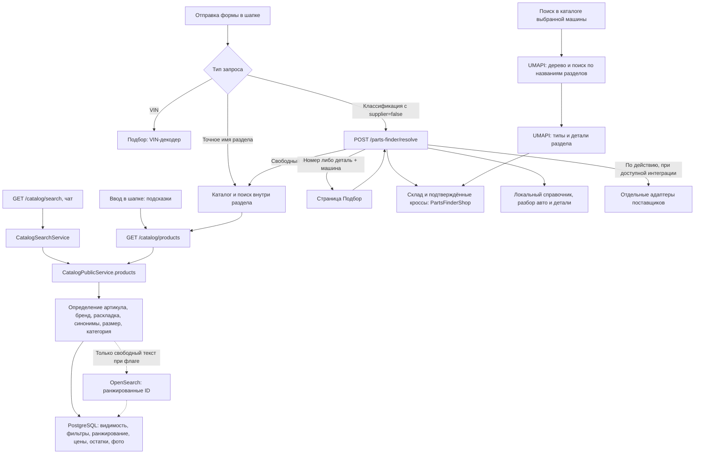

# АН-30 — фаза 0. Аудит поиска и данных

25.11.2026. Срез исходников — `origin/main` `8fb740d`. На an30.ru фронтенд из `182bfc6`, API и воркер из `888543c`. Между `888543c` и срезом аудита нет diff в `apps/api`, `apps/worker`, `packages/database` и `packages/contracts`. Анонимный доступ возвращает HTTP 401. Контейнеры работоспособны, таймер резервных копий активен. Проверки PostgreSQL выполнялись с `READ ONLY`. Проверки поиска запускали класс развёрнутого API напрямую, без HTTP-журнала и вызовов поставщиков.

## Архитектура и эксплуатация

| Узел | Как устроен |
| --- | --- |
| Витрина и админка | Next.js 16, App Router, `apps/web`. Общие API-контракты Zod в `packages/contracts`. |
| API | NestJS + Fastify, `apps/api`. Caddy разделяет витрину и API, завершает TLS, закрывает сайт паролем. |
| Данные | PostgreSQL 18. SQL-миграции в `packages/database/migrations`, на сервере применены 63. Redis 8 обслуживает BullMQ, кэши и ограничители. Фото магазина хранятся локально, есть адаптер S3. |
| Фоновые задачи | `apps/worker/src/main.ts`: BullMQ, опрос transactional outbox каждые 5 секунд, контроль просроченного обмена 1С. Внешний индекс и ночной обход Rossko имеют отдельные настройки. VPS запускает бэкап через systemd. |
| Выкладка | Docker Compose на VPS Beget, проект `an30-production`, отдельные каталоги релизов. [Скрипт релиза](../scripts/deploy/production-release.sh) делает бэкап, сборку, миграции и проверку здоровья. [GitHub Actions](../.github/workflows/ci.yml) проверяет lint, типы, тесты и сборку. |

## Точки входа поиска

| Вход | Правила и источник расхождений |
| --- | --- |
| Подсказки шапки | [search-box.tsx](../apps/web/app/(store)/_components/search-box.tsx) использует `/catalog/products` и отдельно подсказывает разделы. Точный VIN получает отдельную ссылку. Ответ подсказок ограничен по размеру и идёт без контекста раздела или конкретной машины. |
| Отправка из шапки | Точное имя раздела открывает его, идентификатор и «деталь + машина» маршрутизируются через `/parts-finder/resolve`, свободный текст открывает каталог. Касание готовой подсказки ведёт прямо на карточку. Это уже разные результаты при одном вводе. |
| Каталог и раздел | [CatalogPublicService](../apps/api/src/catalog/catalog-public.service.ts) применяет дерево категории, бренд, остаток, цену, тип ТС, сортировку. Тип ТС означает класс вроде легкового или грузового. Фильтра по конкретной модификации в этом контракте нет. Обёртка `/catalog/search`, которую также использует чат, делегирует той же функции. |
| «Подбор» | [PartsFinderService](../apps/api/src/parts-finder/parts-finder.service.ts) классифицирует VIN, номер и текст. Для номера использует точечный поиск склада и кроссов, для текста с машиной — распознавание из справочника, возможные переходы по категориям и отдельную оркестрацию поставщиков. Для части сценариев считает результаты через `CatalogPublicService`. |
| Каталог по машине | [UmapiCarCatalogueService](../apps/api/src/umapi/umapi-car-catalogue.service.ts) ищет по дереву разделов (`matchCarCategories`). Он читает детали только после выбора раздела и локально сопоставляет их с нашим ассортиментом. Поиска по названиям деталей, OEM и артикулам через весь каталог машины здесь нет. |
| VIN | Отдельный маршрут «Подбора», декодер и выбор модификации. Внешние ключи FAPI и TecDoc на VPS отсутствуют. Обычный поиск по товарам VIN не декодирует. Проверку валидных и ошибочных VIN по приёмке перенести на стенд с фикстурами. |
| Админка и SEO | Админский поиск работает по своим таблицам и правилам. Sitemap читает публичные URL и видимость в PostgreSQL. Служебные черновики и SEO не должны получать потребительское ранжирование автоматически. |

**Движок на сервере — PostgreSQL.** [SQL](../apps/api/src/catalog/catalog-search-sql.ts) использует `sku_normalized`, свёрнутые поля названия и `search_text`, бренд, признаки категории и кроссы. Для текста работают раскладка, синонимы, словоформы, триграммы и ограничение расстояния редактирования. При нуле строгих текстовых совпадений возможен ослабленный режим `any`. Распознанный артикул не должен расширяться на похожие номера. [Словарь брендов](../apps/api/src/catalog/catalog-search-identity.ts) для разбора «бренд + артикул» статический и отличается от справочника брендов базы. API пока отдаёт только `matchedVia=query|cross`, без отдельных признаков точного SKU, OEM и источника соответствия.

**OpenSearch уже предусмотрен и выключен.** Его воркер читает `app.search_index_queue` и строит документы с названием, SKU, брендом, категорией, измерениями, ценой и остатком. `search_text` со словами, развёрнутыми из сокращений 1С, в документе отсутствует. Триггеры очереди охватывают товар, цену, остаток, бренд и категорию. Применимость, подтверждение кросса и фото требуют отдельной проверки перед любым расширением индекса. При включении полная замена переключает алиас, выдача повторно проверяет видимость в PostgreSQL. Рекомендация для фаз 1–5 — оставить PostgreSQL и сравнить поиск на одинаковых данных до обсуждения нового движка. [Устройство движков](SEARCH_ENGINE.md).

## Источники данных и обмен

| Факт | Каноническое место сейчас и пробелы |
| --- | --- |
| Позиция | `app.products.id`; при обмене идентичность задаёт `(one_c_source, external_id)`. SKU и `sku_normalized` в той же строке. Один артикул может принадлежать нескольким позициям. В срезе 42 723 активных товара, бренд привязан у 14 174. |
| Бренд и раздел | `app.brands`, `app.brand_identities`, `app.categories`. Код сопоставления кроссов использует `canonical_brand`. Дерево витрины связано с правилами раскладки 1С. |
| OEM и кроссы | OEM для карточки сейчас извлекается из названия (`catalog-original-numbers.ts`), есть отдельные маршрутные данные подбора. Выделенного реестра типизированных идентификаторов нет. `app.article_crosses` хранит нормализованные и исходные пары, статус, происхождение и решение сотрудника. В срезе 829 пар, из них 1 подтверждена и 828 ожидают подтверждения. UMAPI указан в 498 парах, Rossko — в 332; у одной пары источники совпали. Подтверждённые пары расширяют выдачу на один шаг. Текущее поле `relation` имеет более узкую семантику, чем предложенные OEM/замены/направленные связи в брифе. |
| Автомобиль и применимость | `app.vehicle_catalog_makes/models/modifications` — локальный справочник, 90 658 активных модификаций. `app.parts_fitment` поддерживает импорт собственной применимости по марке, модели, двигателю, годам и номеру. На продакшене в этой таблице 0 строк. Наличие справочника автомобилей само по себе не позволяет подтвердить совместимость товара. |
| Фото | `app.product_images` + `app.storage_objects`: собственное фото, 1С или лицензированный пакет, при наличии хранится основание для прав. В текущем срезе `product_images` пустая. Уже сохранённые ссылки/характеристики UMAPI хранятся в `app.product_catalogue_cards`: 73 записи, у 67 есть фото. Служебный архив `app.umapi_product_photos` содержит 62 привязки и 1 сохранённый JPEG, отдельный от витрины. [Механизм хранения и отзыва](PRODUCT_PHOTOS.md). |
| Цена и остаток | История в `app.product_prices`, текущая цена — `app.current_product_prices`; 42 032 цены RUB. `app.inventory_balances` и активные склады дают доступное количество за вычетом резерва, 17 365 позиций с положительным остатком. |

**1С.** Работающий стандартный обмен CommerceML загружает отдельно `import*.xml` для каталога и `offers*.xml` для цен и остатков. Запуск инициирует 1С, а длительность, прогресс и отклонения фиксируются в `app.one_c_exchange_runs`. Порции по 500 строк, продолжение после ошибки, дедупликация завершённого файла по SHA-256, мягкое снятие с витрины, страховка от неполной полной выгрузки. Категории определяют закрепление сотрудником, маппинг группы, словарь деталей и маршрут на разбор. Админская загрузка JSON отдельно поддерживает preview/apply/rollback и версии строк; эти возможности нельзя приписывать стандартному CommerceML. На сервере найдены два завершённых прогона от 23.11, каталог (42 811 обработанных строк) и предложения (59 398), оба с нулём отклонений. Подтверждения регулярного обмена живого узла эти две записи не дают. Первый живой файл должен сохранить стабильный код номенклатуры для привязки к ранее загруженным карточкам. [Контракт и репетиция](ONE_C_INTEGRATION.md). [Разделы магазина](OWN_CATALOG.md).

**Каталог по машине.** Локальные поколения и двигатели выбираются без платных вызовов. Дерево доступных разделов выдаёт провайдер по ID модификации, для группы запрашиваются типы и детали. Проверка склада использует количество, бренд + номер и подтверждённые кроссы. Выдача сначала показывает наши позиции, каталог «под заказ» живёт в отдельной части. Поиск «Давления» сейчас сопоставляет слова разделов, поэтому детали с этим словом могут оказаться недоступными через этот вход. В записи Crown `_S17_` существуют два разных кузова: седан 1999–2004 и универсал 1999–2007. Их следует группировать, сохраняя оба диапазона и ID модификаций.

**Фото.** Листинг и подсказки используют собственную миниатюру, далее сохранённое фото конкретного товара, далее заглушку. На карточке запрос фото запускает свежую идентификацию UMAPI. Для аналога в ответе есть маркировка, аналог не сохраняется как собственное фото. При этом при подборе фото часть путей считает кандидатами неподтверждённые пары и ответы Rossko, а сохранённая точная карточка производителя может показываться на витрине автоматически. Обе политики требуют решения до изменения цепочки и запуска фонов. Ссылки производителя в текущей реализации ведут на внешний источник, а общая функция `resolvePhoto` для листинга, карточки и фидов не выделена. [Разрешения и лимиты](PROVIDERS.md).

**Площадки и аналитика.** Найдены sitemap, структурированные карточки и локальные данные витрины. Marketplace-фидов или общего `published_view` с quality gate в проверенном коде нет. Каталожный журнал хранит очищенный запрос, число результатов и время, пропускает телефоны, email и полные VIN. За семь дней — 538 записей и 21 нулевая. Это объём событий и доля среди них, включая подсказки, а конверсию и долю нулевых пользовательских сессий из этих данных вывести нельзя. Есть технические cookie, история запросов в `sessionStorage`, выбор машины в `localStorage`, внутренний расчёт популярности. Плашка выбора аналитики/маркетинга и внешняя аналитика в проверенных точках не найдены. Страница карты встраивает сторонний виджет, этот сценарий требует отдельной проверки согласий.

## Контрольная выдача на ассортименте

Запуск на боевом классе каталога с `sort=relevance`, верхними 10 позициями, без раздела и выбранной машины. 20 запросов охватывают проверки поиска по SKU/OEM/кроссу, спецификаций, раскладки и пустой выдачи. Это базовый срез поискового метода, а приёмка маршрутизации шапки, VIN и каталога машины — отдельные сценарии.

| Случай | Результат |
| --- | --- |
| Все 5 вариантов STELLOX 81-00110-SX | KF6009SP ни разу не в топ-10. Три запроса без бренда дали 0; два запроса с брендом — по 167 в режиме `any`. В БД есть неподтверждённая пара STELLOX ↔ KAMAZ 0091012005, а KF6009SP без привязанного бренда содержит 009-1012005 в названии. Дополнительно разбор бренда не распознаёт STELLOX как строгий ввод «бренд + артикул». |
| KF6009SP, kf 6009 sp | Одна нужная позиция, № 1 в обоих запросах. |
| 87139-28010, 8713928010 | По одному результату ST-87139-28010; LAC143 отсутствует в выдаче, хотя номер присутствует в его названии. Данные не подтверждают связь IVECO с этой позицией; у одноимённого номера другой контекст. |
| LAC-201C, LAC201C, lac 201c | LAC-201C № 1 во всех трёх вариантах. В БД есть карточка LYNXAUTO с одним фото; размер из брифа отдельно по источнику не проверяли. |
| ST-46420-28400 | Находится собственный SKU № 1, `matchedVia=query`. Привязку фото аналога и его точный источник нужно подтвердить отдельно. |
| DOT-4, dot4, ДОТ 4 | Наборы различаются: для «тормозная жидкость DOT-4» 10 строк, для `dot4` — 5, для «ДОТ 4» — 36. |
| Антифриз красный 5кг, Аляска G11 | Целевая позиция 00-00026453 на 4-м и 1-м местах соответственно. |
| ghbdtn, xxzzqq | `ghbdtn` дал один автоматический результат ATSTA 70-3-R. Подсказка раскладки в шапке показывается только при пустой выдаче. `xxzzqq` дал 0; переход к заявке проверять отдельным UI-тестом. |

Для фазы 1 в `tests/golden/search.yaml` стоит явно различить ожидаемый товар, причину, допустимую подсказку и ожидаемый ноль. Для проверки recall@10 идентификаторов нужны зафиксированные подтверждённые связи и опубликованные товары. Для паритета сравнивать одинаковые запрос **и контекст**, в том числе сортировку, фильтры, выбранную модификацию и доступность. В репозитории есть регрессионный набор из 188 запросов на фикстурах и скрипты замеров по ассортименту. Регрессия PostgreSQL требует отдельной БД, а текущий GitHub Actions не поднимает её для этого набора и не запускает Playwright E2E. [Текущие проверки поиска](../scripts/search-checks/README.md). [Проверки витрины](../scripts/storefront-checks/README.md).

## Мобильный срез и риски

Playwright WebKit, профиль iPhone, 390×844. Главная, «Антифриз», KF6009SP и «Подбор» вернули 200. На первичном прогоне нет горизонтального переполнения, в повторном прогоне нет необработанных JS-ошибок на этих страницах. На KF6009SP виден длинный заголовок из 1С (D-02), блок крошек присутствует. Проверка не включала отправку форм, расшифровку VIN, нажатия платных кнопок или реальные мобильные клавиатуры. Снимки сделаны локально, внешние запросы и платные маршруты браузера заблокированы. Состав D-01…D-17 — очередь проверки из брифа, остальные дефекты требуют воспроизведения на утверждённых примерах. Повторное отображение двух панелей совместимости и набор состояний «нет данных» проверяются отдельными тестами.

| Приоритет | Риск и условие дальнейшей работы |
| --- | --- |
| P0 | Фото по неподтверждённой связи или публикация без согласованного права показа. Зафиксировать разрешения по источнику и типу фото, закрепить отбор подтверждённых кроссов в тестах. |
| P0 | Подмена точного OEM/артикула широким поиском, несовпадающие причины попадания. Фикстуры из реальных данных, без подтверждения связи по соседству номера в названии. |
| P0 | При первом полноценном CommerceML без кода номенклатуры возможны новые строки и скрытие существующих. До реального применения проверить diff на копии. |
| P1 | Нулевая локальная применимость и пересекающиеся диапазоны автомобилей. Разделить группировку для UI и идентичность модификаций. Паритет имеет смысл только при наличии подтверждённых связей. |
| P1 | Дополнительные запросы к провайдерам во время набора и фоновое сохранение нарушат текущие границы тарифа и хранения. Фикстуры, счётчики и отдельные бюджеты до подключения нового пути. |
| P1 | Невозможность сравнить мобильные сценарии и частоту ошибок при изменении маршрутизации. Зафиксировать базу на стенде в WebKit и Chromium, включая известные E2E-падения. |
| P2 | Подключение OpenSearch до выравнивания полей, фиды до подтверждения рынков и аналитика до согласований создадут расхождения с витриной. |

## План после согласования аудита

Оценки в рабочих днях одного разработчика, ожидание макета, доступа, лицензии и ответа владельца считается отдельно.

| Фаза | Оценка | Результат и проверка |
| --- | --- | --- |
| 1. Тестовая основа | 2–3 | Golden YAML, снимки «до», E2E на стенде и CI, сценарии зафиксированного состояния. |
| 1b. Быстрые правки | 2–3 | Крошки, состояния карточки, мобильная сетка, сортировка, иконки. Варианты на 375–390 px до кода. |
| 2. Идентификаторы и входы | 4–7 | Общая нормализация, типизированные идентификаторы и доказательства поверх существующих таблиц, общая локальная выдача, сравнение в shadow под флагом. |
| 3. Кроссы и фото | 3–6 | Рассогласования в маркировке и типах связи исправлены, подтверждённые аналоги в выдаче, фото по согласованным правам. |
| 4. Текст | 3–5 | Одна версия словарей, сценарии опечаток и раскладки, проверка точных номеров без ложных расширений. |
| 5. Каталог машины | 3–6 | Поиск деталей при выбранной модификации, группировка без потери ID, различимые состояния совместимости. |
| 6. UI/UX | 3–6 | Утверждённые макеты, доступны плитка и список, фильтры, карточка, меню и заявка. Может идти параллельно после стабилизации контракта. |
| 7. Согласие и блоки | 3–6 | Версия согласия, отключённые до выбора внешние сценарии, метрики и блоки после согласования текстов. |
| 8. Импорт 1С | 4–8 | Прогон по реальному договорённому формату на копии, dry-run/сверка/восстановление, расписание и мониторинг. |
| 9. Фиды | 2–4 на площадку | Один набор публикации, валидатор, dry-run и отчёт по SKU/цене/остатку/фото. |
| 10. Навыки проекта | 1–2 | Правила поиска, импорта, UI и golden-тестов оформлены для следующего агента. |

Фазу 2 переключаем после проверки одинакового контекста и 100% recall@10 на подтверждённых идентификаторах, замера на ассортименте, согласованного бюджета задержки и проверки отката флагом. Миграции добавочные. Проверки и выкладка происходят по правилам репозитория, выкладка — по отдельному указанию владельца.

## Вопросы владельцу

1. Какие режимы UMAPI подтверждены лицензией для точного фото, фото аналога, характеристик и применимости? Уточнение после ранее разрешённых свежего запроса для посетителя, кэша до суток и внутреннего архива в 1С: можно ли автоматически показывать сохранённое точное фото следующему посетителю или оставить его только в служебном режиме? Какие действия, кроме кнопки «Показать фото и характеристики», требуют свежего вызова?
2. Кто и по какому документу подтверждает пару STELLOX ↔ KF6009SP и OEM 87139-28010 ↔ LAC143? Какие источники считаем достаточными по кроссам Rossko/UMAPI/1С, включая тормоза, рулевое и подвеску? Подтверждены ли лимиты и ночной обход Rossko для запуска на всём ассортименте?
3. Какой узел 1С:УНФ подключаем, с какой частотой для каталога и предложений и с каким типом цены? Под «карточкой 1С» нужен перенос одобренного фото в номенклатуру или двустороннее редактирование полей между админкой и 1С?
4. На какие площадки готовить выгрузки и какие у каждой цены, наценки, доступность и договор на передачу фото?
5. Кто согласовывает тексты cookie и персональных данных, включая виджет карты? Какие целевые p95, долю нулевых поисковых сессий и конверсию в корзину принимаем после замера базы?

До согласования аудита следующий этап остаётся на проверке владельцем.
