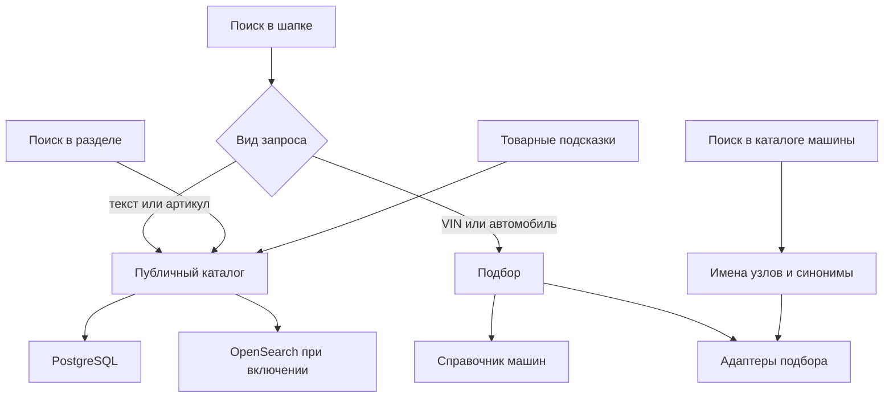

# АН-30. Аудит перед запуском, 26 ноября 2026

Исходная версия — `8fb740d` ветки main. Этот коммит совпал с вершиной ветки на странице GitHub при проверке в браузере. В текущей оболочке fetch завершился ошибкой DNS. Проверены исходники, миграции, скрипты, документация, сборка и доступные локальные тесты. Производственные показатели и остатки тарифов не измерялись. Предмет проверки — [ТЗ владельца](../AGENT_BRIEF.md).

## Что мешает выпуску

| Очерёдность | Находка и основание | Приёмочная проверка |
|---|---|---|
| 1 | Процедура закрытого релиза разрешала продолжить при выключенном пароле. Изолированный запуск исходного скрипта дошёл до резервного копирования во всех пяти ошибочных конфигурациях. | Проверить итоговую конфигурацию Caddy до резервного копирования, сборки и миграций. Проверить отказ и разрешённый путь. |
| 2 | Чат может показать вложение из предыдущей беседы. Ответ на отправку приходит после смены обращения, а обработчик меняет текущую ленту и курсор. | Открыть B во время незавершённого POST в A, вернуть ответ A. Проверить обе истории и курсоры. |
| 3 | Покупатель может получить сообщение о неудаче после создания заказа. В checkout-client.tsx запись подтверждения в sessionStorage находится в том же блоке обработки ошибок, что и POST. | Успешный ответ API и исключение при записи в хранилище. Увидеть подтверждение и убедиться, что повторный заказ не создан. Отдельно проверить гостевой доступ к актуальному статусу. |
| 4 | Префикс бренда меняет ключ поиска подтверждённых кроссов. При совпадении номера у двух брендов особенно важен бренд исходной детали. | Идентичные результаты по вариантам номера, отсутствие чужого бренда и источника, отдельные проверки rejected/unconfirmed. |
| 5 | Автотесты и отчёт страниц пока недостаточны для запуска. pages-audit.mjs пропускает карточку без найденной ссылки и допускает несохранённый снимок. | Известный товар обязателен в прогоне, артефакт открывается. Пройти гостевую покупку, регистрацию, работу оператора, восстановление из бэкапа. |

## Как устроен проект

Next.js 16 обслуживает витрину и админку в `apps/web`. NestJS и Fastify в `apps/api` обслуживают HTTP и чат через WebSocket. PostgreSQL хранит каталог, заказы, сообщения, результаты обменов и outbox. Воркер `apps/worker` читает события, отправляет уведомления, обновляет индекс. Redis используется в том числе для временных ответов, лимитов и обмена событиями. SQL-миграции в `packages/database`, контракты в `packages/contracts`. В закрытом production Caddy стоит перед сервисами Docker Compose. Процедура выпуска сохраняет архив данных и запускает новый релиз; проверка доступности извне и восстановление из архива требуют отдельного прогона. В CHANGELOG последняя описанная выкладка — `182bfc6` от 25 ноября.

### Маршруты поиска

| Вход | Реализация и расхождение |
|---|---|
| Шапка и подсказки | `_components/search-box.tsx` выбирает переход в общий каталог, подбор по машине или VIN. Товарные подсказки запрашивает через /catalog/products, категории получает отдельно. |
| Список, раздел, старый адрес поиска | Страницы `catalog/(index)` и `catalog/[...slug]` вызывают searchCatalog, раздел передаёт categorySlug. `catalog-search.service.ts` делегирует в публичный сервис. При одинаковом фильтре ожидается одинаковый набор товаров. |
| Каталог машины | `umapi-car-catalogue.service.ts` и `matchCarCategories` ищут среди названий узлов дерева и синонимов. Открытие раздела загружает детали и сопоставляет наличие. Поиск по названию каждой детали всего дерева отсутствует. |
| VIN и «деталь + машина» | `parts-finder` определяет вид запроса. Выбор машины читает локальный справочник, запрос VIN идёт по отдельной цепочке. Фоновая загрузка всего дерева для обеспечения паритета нарушила бы лимиты. |
| Сотрудник и площадки | `staff.service.ts` ищет по имени, SKU и внешнему ID, включая непубличные данные. Внешний контракт видимости для покупателя нужен отдельно. Товарных фидов площадок в коде не обнаружено. |

`catalog-public.service.ts`, `catalog-search-sql.ts` и `catalog-search-identity.ts` реализуют словари, раскладку, словоформы и строгую артикульную ветку. SQL ранжирует точный SKU, подтверждённый кросс, префикс, тип детали и текстовое сходство с учётом наличия. Опциональный OpenSearch обрабатывает свободный текст. Поля описывает `apps/worker/src/search-index/index-definition.ts`. Миграция 0035 ставит события для товаров, цен, остатков, брендов и категорий. Слова-расшифровки 1С в SQL и OpenSearch различаются. В ответе matchedVia различает query/cross. В журнале поиска есть очищенный запрос, число результатов и время. Связку показа с кликом и покупкой из ТЗ ещё предстоит спроектировать с учётом согласия.

**Воспроизведено на функции разбора.** Для «81-00110-SX» и «81 00110 sx» получен ключ 8100110SX, для «STELLOX 81-00110-SX» — STELLOX8100110SX. Для «8500986_SX» не получен ключ строгой артикульной ветки, для «8500986-SX» — 8500986SX. Варианты «KF6009SP» и «kf 6009 sp» дают один ключ. Это результат разбора строки. Применимость деталей, принадлежность кросса или выдачу реальных карточек он установить не позволяет. Нужны данные магазина и проверка подтверждения пары.

### Модель данных, фото и поставщики

| Данные | Канон и границы |
|---|---|
| Товар, цена, остаток | В схеме app таблицы products, brands, categories, product_prices и inventory_balances. Идентичность товара при обмене задают источник и ID из 1С. Продажа учитывает цену и остаток. |
| Кроссы и OEM | article_crosses хранит пару с брендами, источник и статус. Миграции 0018, 0042 и 0063. В публичной артикульной выдаче разворачивается один подтверждённый шаг. Отдельный режим includeOeSiblings может дать **возможный** аналог через общий OEM. Для требования «один шаг» этот режим проверять отдельно. |
| Машины и применимость | vehicle_catalog_* из миграции 0056 содержит локальные марки, модели и модификации UMAPI. parts_fitment из 0038 хранит артикул, бренд, признак OEM и источник. Это отдельная модель от предложенных в ТЗ связей конкретного товара и модификации со статусом проверки. |
| Фото | product_images хранит привязки разрешённых изображений; бинарные файлы собственных фото лежат на диске или в S3. В точной каталожной карточке и служебном архиве 1С действуют отдельные правила. Происхождение, права и удаление — [матрица поставщиков](../PROVIDERS.md). |

### Обмен 1С, публикации и аналитика

Основная и вторая база сами инициируют CommerceML по HTTP. Фазы checkauth, init, file и import принимают каталог, предложения, цены, остатки и фото. Первичное сопоставление идёт по коду; для полной загрузки возможна однозначная пара артикул + название. Одинаковый SKU у разных товаров недостаточен для объединения. Завершённый файл узнаётся по SHA-256. Для отдельного JSON-протокола есть preview/apply и проверка externalBatchId с хешем. Категорию определяют закрепление сотрудником, правила, группы 1С и классификация по данным товара. Остаточные позиции попадают на разбор. Первый реальный файл и фактическое расписание контролируются в 1С. Полный цикл на производственных данных в этом аудите не запускался. См. [документ обмена](../ONE_C_INTEGRATION.md) и [каталог магазина](../OWN_CATALOG.md).

Worker Client Hub публикует редакционные посты в Telegram, MAX и VK, для WhatsApp создаёт ручную задачу. Генераторы товарных объявлений маркетплейсов и сверочный отчёт цен/остатков не обнаружены. Sitemap уже есть. В админке доступны состояние обменов и отчёты. В витрине есть история просмотров, избранное, обычные блоки каталога и наличия. В описании сайта указаны технические cookie. Плашка с тремя категориями, версией согласия и изменением выбора из футера, а также персональный скоринг из ТЗ требуют отдельной реализации.

## Мобильный каталог и карточка

Ниже состояние по коду. Для визуального утверждения нужны одинаковые данные на сравниваемых экранах, макет и снимки. Номера соответствуют разделу 3 ТЗ.

| ID | Что установлено | Чем принять |
|---|---|---|
| D-01 | У карточки есть цепочка категорий. В storefront.module.css последний элемент ограничен 70vw и обрезается. | Длинное название и крошки на 375/390 px, базовая линия разделителей, доступ к полному тексту. |
| D-02 | Импорт очищает публичное название, но пример KF6009SP на реальном товаре не проверен. | Сравнить сырой текст и заголовок в списке и карточке после повторного импорта. |
| D-03 | ProductCatalogueCheck строит раскрываемый список и для пустого результата выводит сообщение внутри. | 0, 1 и несколько применимостей, выбранное авто, ошибка и ожидание ответа. |
| D-04 | На узком экране у заглушки уже есть вариант 80×80. | Карточки с фото и без него в обоих видах, сохранение места и доступ к запросу фото. |
| D-05 | Переключатель есть. До 480 px плитка становится одноколоночной горизонтальной карточкой, визуально близкой к списку. | Две колонки плитки и компактные строки списка по согласованному макету. |
| D-06 | На телефоне фильтры уже открываются снизу, сортировка остаётся select. | Длинный вариант сортировки целиком, возврат фокуса, применение и сброс. |
| D-07 | У подразделов есть файлы картинок. Мобильное меню рисует изображение родителя и только текст у детей. | Раскрыть бургер, увидеть правильные иллюстрации детей и понятный вариант при ошибке файла. |
| D-08 | Аналоги магазина представлены ссылками; полное отображение карточками и под заказ требует проверки/доработки. | Подтверждённый аналог, неизвестная пара, переход по ссылке и возврат без потери позиции. |
| D-09 | Выборка поколений сортирует строки. Объединение пересекающихся записей Crown по кузову не найдено. | На копии справочника сравнить идентификаторы, кузов, рынки, двигатели и годы до объединения. |
| D-10 | Поиск «Давления» обрабатывает дерево и синонимы разделов. | Близкие разделы и детали для выбранной машины, содержательный нулевой результат. |
| D-11 | Блоки «Под заказ» уже реализованы в каталоге и подборе. | На фикстуре сравнить подтверждение, наличие, сортировку и запрос менеджеру. |
| D-12 | Отображение групп VIN для указанной Honda требует записанной разрешённой фикстуры. | Заголовок без склейки, однозначный исходный раздел и источник внутри системы. |
| D-13 | Расхождение ключа артикульного поиска воспроизведено. | Один тест на каждый вариант написания и контроль номера у другого бренда. |
| D-14 | Поиск и подпись фото аналога есть. Конкретная пара ST-46420-28400 и источник фото в боевой БД не проверены. | Проверить точное, подтверждённое альтернативное, отозванное и отсутствующее фото на тестовых данных. |
| D-15 | Анимация подсказки учитывает reduced-motion и пустое поле. | Проверить фокус, набор, вставку, автозаполнение и имя поля в дереве доступности. |
| D-16 | Ссылка к специалисту может передать запрос; авто и артикул в анкете по умолчанию пустые. Снимок результатов не передаётся. | Оператор получает выбранную машину, исходный запрос, товар и доступный контекст обращения. |
| D-17 | Выбор авто в блоке реализован частично. | Пройти состояния без авто, подтверждено, неизвестно и нет данных, без заявления о неподтверждённой совместимости. |

## Чат, оформление и проверка задержек

| Очерёдность | Наблюдение в исходниках | Как воспроизвести на заглушках |
|---|---|---|
| 1 | `chat/use-chat-thread.ts` применяет запоздавший результат REST-отправки и загрузки вложения без проверки активной беседы. | Начать в A, переключиться в B, разрешить отложенный ответ. Проверить сообщения, курсор, ошибку и статус отправки как при успехе, так и при отказе. |
| 2 | `chat-realtime.service.ts` возвращает при подписке одну порцию до 100 сообщений. Обработчики покупателя и оператора переходят в live без полного дочитывания. | 101 и 205 сообщений за время разрыва плюс входящее при восстановлении. Проверить порядок, дубликаты и отсутствие пропусков. |
| 3 | Очередь оператора обновляется по queue.event. После повторной queue.subscribed явная перечитка отсутствует. | Создать обращение во время обрыва и восстановить связь без новых событий. |
| 4 | Мобильный /chat может передавать isVisible=true даже при показе списка обращений. | Принять сообщение в скрытой беседе, убедиться в отсутствии read до открытия. |

Отдельно измерить время от нажатия до появления отправленного сообщения и до доставки оператору, ожидание вложения, время восстановления соединения, число запросов и перерисовок. Собрать медиану и p95 на согласованном стенде. Производственных замеров для вывода о причинах всех задержек пока нет.

За пределами чата статический аудит выявил отсутствие полного браузерного пути заказа, несовпадение лимита корзины с контрактом в 100 разных позиций и риск повторов уведомлений при частичном успехе Telegram/VK. Проверять отдельно с фикстурами. Для заказа с уже полученным idempotency key проверять повторную отправку после потери ответа.

## Проверки 26 ноября

- lint и typecheck прошли, production-сборка Next.js завершилась.
- В полном pnpm test прошёл 3191 тест, 303 пропущены. В API упали три файла тестов: пять тестов по таймауту и ошибка настройки S3-фикстуры. В журнале есть запрет listen EPERM для 127.0.0.1 у локальных HTTP/TCP-серверов. Чистого общего прогона нет.
- Изолированные наборы чата прошли: 48 тестов витрины и 49 API. Они не подтверждают четыре сценария выше.
- Поисковый регрессионный набор содержит 188 запросов и использует отдельный PostgreSQL. Локальный PostgreSQL не ответил, реальный набор и ассортимент владельца в этом запуске не исследованы. Предложенного tests/golden/search.yaml в исходной версии нет.
- Браузерная приёмка работающего локального каталога/чата, новые замеры WebKit, контроль прав сотрудников и пробное восстановление резервной копии остаются открытыми. Отчёт от 25 ноября про ошибки значков со статусом 401 — исторический.
- Для планирования и диагностики использованы установленные Superpowers Writing Plans и Systematic Debugging. Для критериев витрины применены UI/UX Pro Max, frontend-design и webapp-testing. Продуктовые макеты и снимки относятся к следующим шагам. Новый дизайн утверждается в Claude Design.

## Порядок работ

Оценки — ориентир в рабочих днях до приёмки на доступном стенде. Каждый пункт выпускается отдельно после собственных проверок. Номера фаз соответствуют ТЗ; чат и надёжность покупки добавлены по приоритетам владельца.

| Этап | Самостоятельный результат и условие перехода | Оценка |
|---|---|---|
| 0. Аудит и закрытый выпуск | Зафиксировать текущую архитектуру, воспроизвести ошибки, проверить блокировку выпуска с выключенным паролем. | 1 |
| 1. База приёмки | Отдельная БД; золотые запросы; baseline до исправлений; реальные снимки 390×844, также 1440/768/375; рабочий прогон в CI. | 1–2 |
| Чат | Один PR на отложенный ответ, следующий на полное восстановление истории; затем очередь, прочтения, контекст и замеры. | 2–4 |
| Покупка | Отказ хранилища после POST, гостевой статус, лимит корзины, сквозной тест с повторной отправкой. | 1–2 |
| 1b и 6. Витрина | По утверждённым макетам: меню с картинками, крошки, фильтры/сортировка, два вида листинга, CTA и фото. Контроль клавиатуры, касания, контраста и reduced motion. | 3–6 |
| 2 и 4. Поиск | Запрос с брендом, OEM и раскладки, строгие коды, синонимы. Сравнение вариантов на одном срезе данных до переключения. | 3–6 |
| 3. Кроссы и фото | Проверить путь «ответ → допустимая запись → повторное чтение → отзыв», определить происхождение на карточке. Фикстуры разных брендов и конфликтующих поставщиков. | 2–4 |
| 5. Авто | Поколения, поиск внутри машины, честные состояния совместимости. Не расширять платные вызовы при наборе. | 2–4 |
| 7. Согласие и персонализация | После утверждения текста и состава данных: выбор, отзыв, версия согласия, персональные блоки. | 2–4 |
| 8. Обмен 1С | Прогон реального обезличенного файла на отдельной базе, повтор, частичное обновление цены и остатка, отчёт категорий и восстановление. | 2–4 |
| 9. Внешние площадки | После выбора площадок, правил цены и прав на фото: один адаптер, пробный фид и сверка с 1С. | 2–5 на площадку |
| 10. Выпуск и сопровождение | Упаковать проверенные правила проекта, зелёный CI, резервная копия и репетиция восстановления, закрытая выкладка, smoke после релиза. | 1–2 |

**Решения владельца перед соответствующей фазой.** Уточнить первую площадку и наценку, разрешённые категории использования изображений, расписание и направление изменений 1С, политику аналитики и целевые показатели текстового поиска. Уже принятые правила по подтверждению кроссов и хранению у каждого поставщика действуют. Универсальный архив сырых ответов из ТЗ требует отдельных оснований для каждого источника. Открытие сайта для покупателей — отдельное решение владельца.
